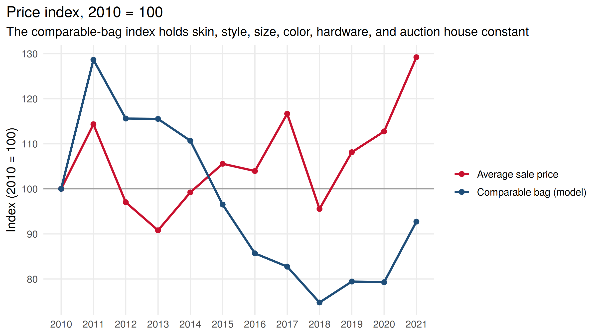
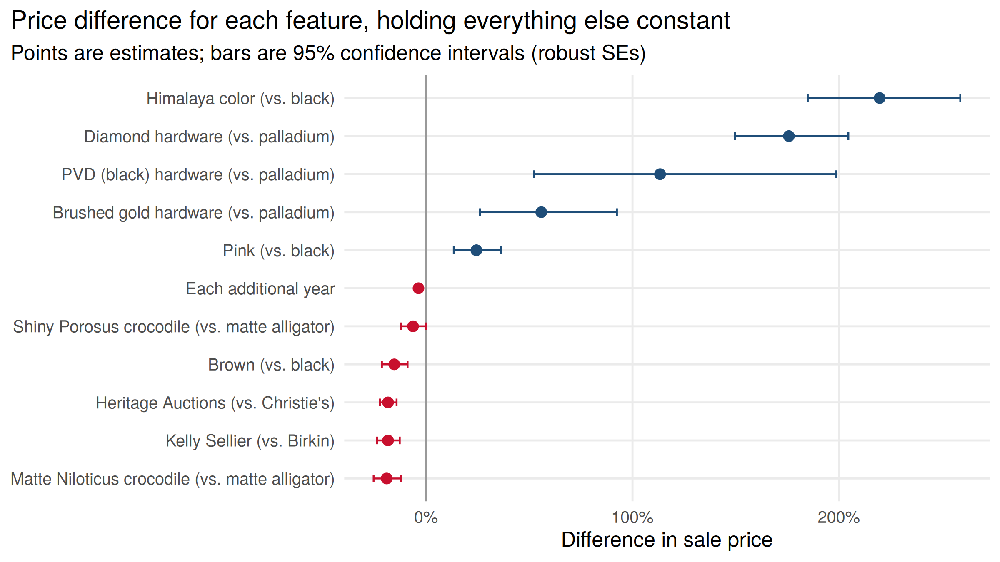

# Are Hermès Bags a Good Investment?

A client owns a collection of Hermès Birkin and Kelly bags and wants to know whether to hold, buy more, or sell, and which bags hold their value best. I used 1,255 auction sales from 2007 to 2021 to find out what actually drives the price of a bag and whether bags are gaining value over time.

## Key findings

- **The average price is misleading.** The mean sale price rose over time, but the median fell. The typical bag sold for less in 2021 than in 2010.
- **The mix of bags changed.** None of the bags sold in 2010 were Himalaya or had diamond hardware. By 2017 those premium bags were 25% of sales, which pulled the average up.
- **Comparable bags got cheaper.** Holding skin, style, size, color, hardware, and auction house constant, the same kind of bag sold for about **3.7% less each year**. By 2018 it was about 25% below 2010, before recovering some in 2021.
- **Rarity drives value.** Himalaya bags sell for **220% more** than a comparable black bag, and diamond hardware adds **176%**.
- **Crocodile isn't automatically worth more.** Matte Niloticus crocodile sells for 19% less than matte alligator once color is held constant. Crocodile only looks more valuable in a simple average because 103 of the 106 Himalaya bags are Niloticus.
- **Where you sell matters.** The same bag sells for about 18% less at Heritage Auctions than at Christie's.

## Recommendation

Don't count on the collection appreciating. Once similar bags are compared, auction prices for most exotic Birkins and Kellys went down between 2010 and 2021. If the client keeps buying, the data supports focusing on the rarest pieces (Himalaya and diamond hardware), not paying extra for crocodile on its own. If the client sells, choosing Christie's over Heritage could matter more than the timing.

## Data

Auction results for exotic-skin Hermès Birkin and Kelly bags sold at Christie's, Heritage Auctions, Poly Auction, Sotheby's, and Artcurial. Each sale records the date, style, size, skin, color, hardware, auction house, and sale price in US dollars. The dataset was provided by my professor for R Programming II at the University of Georgia and is shared here with permission.

## Methods

1. Cleaned category labels and flagged premium bags (Himalaya color or diamond, brushed gold, or PVD hardware).
2. Compared the yearly mean and median sale price, and tracked the share of premium bags sold each year.
3. Ran a hedonic regression of log sale price on time of sale, skin, style, size, hardware, color, and auction house, with robust (HC1) standard errors. The model explains 59% of the variation in log prices.
4. Re-ran the model with a separate effect for each year to build a quality-adjusted price index (2010 = 100).

## Tools

R (tidyverse, readxl, lubridate, sandwich, lmtest, scales, knitr), R Markdown

## Files

| File | What it is |
|---|---|
| `hermes.Rmd` | Full analysis and write-up |
| `hermes.html` | Knitted report, open in a browser |
| `data/hermes.xlsx` | Auction sales data |
| `images/` | Charts used in this README |

## How to run it

1. Clone this repo and open `hermes.Rproj` in RStudio.
2. Install the packages: `install.packages(c("tidyverse", "readxl", "here", "sandwich", "lmtest", "scales"))`
3. Knit `hermes.Rmd`.

## Limitations

These are auction prices only, so private resale and boutique prices could behave differently. Prices aren't adjusted for inflation, so the real decline is larger than shown. There are few sales before 2013, which makes the early years less precise. The data also doesn't record a bag's condition, which is likely a big part of what the model leaves unexplained.

## Background

This started as my final project for R Programming II at UGA in Spring 2025. My first version tracked average prices and Reddit sentiment and concluded that prices were rising. When I went back to it, I rebuilt the analysis at the individual bag level, which showed the rising average came from a changing mix of bags rather than bags gaining value. I dropped the sentiment analysis because the sample was too small to support a conclusion.

---

**David Barrero** · [LinkedIn](https://www.linkedin.com/in/david-barrero1) · [GitHub](https://github.com/david-barrero)
